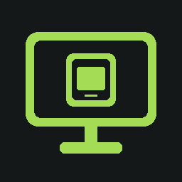

<p align="center">
  
</p>

<h1 align="center">ScreenMirror</h1>

<p align="center"><strong>គ្រប់គ្រងឧបករណ៍ Android និងឆ្លុះអេក្រង់មក Windows ដោយប្រើ ADB និង scrcpy។</strong></p>
<p align="center"><a href="README.md">English</a> · <a href="README_KM.md">ខ្មែរ</a></p>
<p align="center">
  
  
  
</p>

ScreenMirror ជាកម្មវិធី **Python សម្រាប់គ្រប់គ្រងឧបករណ៍ Android និងឆ្លុះអេក្រង់មក Windows** ដែលមានអាជ្ញាបណ្ណ MIT និងផ្ទាំងកម្មវិធី PySide6។ វាប្រើ Android Debug Bridge (`ADB`) សម្រាប់ស្វែងរក និងភ្ជាប់ឧបករណ៍ ហើយបើកដំណើរការ scrcpy ដែលភ្ជាប់មកជាមួយនៅក្នុងបង្អួចដើមរបស់វា សម្រាប់បង្ហាញអេក្រង់ បញ្ជាឧបករណ៍ និងថតវីដេអូតាមជម្រើស។

> **សិទ្ធិចូល repository:** GitHub repository នេះមានស្ថានភាព private; ត្រូវមានសិទ្ធិអនុញ្ញាតដើម្បី clone source code។ មិនទាន់បានផ្ទៀងផ្ទាត់ថាមាន GitHub Release package សម្រាប់ទាញយកទេ។ សូមមើលមគ្គុទ្ទេសក៍ដំឡើងសម្រាប់ការប្រើ source និង package។

## មុខងារដែលមាន

- ស្វែងរកឧបករណ៍ Android តាម USB និង Wireless ដែលបានអនុញ្ញាត ដោយប្រើ Windows Platform-Tools ដែលភ្ជាប់មកជាមួយ។
- ចាប់ផ្តើម/បញ្ឈប់ ADB server, ផ្គូផ្គង/ភ្ជាប់/ផ្តាច់ឧបករណ៍ Wireless និងពិនិត្យស្ថានភាពឧបករណ៍។
- ចាប់ផ្តើម និងបញ្ឈប់ការឆ្លុះអេក្រង់ក្នុងបង្អួច native របស់ scrcpy។ ScreenMirror មិនបកស្រាយ ឬបង្ហាញស៊ុមវីដេអូដោយខ្លួនឯងទេ។
- កំណត់ resolution, FPS, bitrate, codec ដែល scrcpy គាំទ្រ, ការបញ្ជូនសំឡេង, fullscreen, stay-awake និង screen-off។
- ថតរូបអេក្រង់ PNG ពីឧបករណ៍ដែលបានជ្រើស។
- កំណត់ការថតវីដេអូរបស់ scrcpy សម្រាប់សម័យឆ្លុះអេក្រង់ (UI បង្ហាញជម្រើស MP4/MKV)។
- ជ្រើស UI ជា English ឬ Khmer ហើយកម្មវិធីរក្សាទុកជម្រើសនេះសម្រាប់ពេលបើកក្រោយ។
- មើលព័ត៌មានសេវាកម្ម និងកំណត់ហេតុវិនិច្ឆ័យក្នុងកម្មវិធី។

### មានមុខងារ មិនមានន័យថាបានសាកល្បងជាមួយទូរស័ព្ទពិត

បច្ចុប្បន្នមាន **49 unit tests ជោគជ័យ** ហើយបាន build និងបើកកញ្ចប់ Windows លើម៉ាស៊ីនអភិវឌ្ឍន៍។ ការតេស្តទាំងនេះ **មិនបញ្ជាក់ភាពឆបគ្នាជាមួយ Android hardware ទេ**៖ មិនបានប្រើទូរស័ព្ទពិតសាកល្បង discovery, pairing, mirroring, input, audio, screenshot ឬ recording ឡើយ។

## Platform និងតម្រូវការ

- **Desktop ដែលគាំទ្រ:** Windows x64។ ការអភិវឌ្ឍន៍ និង package smoke test បានធ្វើលើ Windows 10 (build 19045)។ គម្រោងមិនបានកំណត់ Windows version អប្បបរមាជាផ្លូវការទេ។
- **Android:** ត្រូវបើក ADB debugging និងអនុញ្ញាតកុំព្យូទ័រនេះ។ មិនមានបញ្ជី Android version ដែលបានបញ្ជាក់ថាគាំទ្រទេ។
- **Wireless ADB:** ទូរស័ព្ទ និងកុំព្យូទ័រត្រូវអាចទាក់ទងគ្នាតាមបណ្តាញដែលទុកចិត្តបាន ហើយទូរស័ព្ទត្រូវមាន Wireless debugging/pairing សម្រាប់របៀបប្រើនោះ។
- **Python:** បានប្រើ Python 3.13.3 សម្រាប់តេស្ត និង build ចុងក្រោយ។ មិនបានកំណត់ Python version អប្បបរមាជាផ្លូវការទេ។
- **ឧបករណ៍ភ្ជាប់មកជាមួយ:** Windows Platform-Tools 37.0.1 និង scrcpy 5.0.1។ អ្នកប្រើមិនចាំបាច់ដំឡើង ADB ឬ scrcpy ដាច់ដោយឡែកទេ។
- **CPU/RAM/GPU:** មិនទាន់មានការវាស់វែងដើម្បីកំណត់តម្រូវការអប្បបរមាទេ។

ថត ADB របស់ macOS និង Linux នៅតែមានក្នុង workspace ប៉ុន្តែមិនមានន័យថាផ្ទាំងកម្មវិធី, scrcpy runtime ឬ package ត្រូវបានគាំទ្រលើប្រព័ន្ធទាំងនោះទេ។

## ទាញយក និងដំឡើង ScreenMirror

### កញ្ចប់កម្មវិធីរួចរាល់

មិនអាចផ្ទៀងផ្ទាត់ថាមាន GitHub Release ដែលអាចទាញយកបានទេ។ Repository មានស្ថានភាព private ហើយ build ក្នុង `dist-easy-run` គ្រាន់តែជាកញ្ចប់ក្នុងម៉ាស៊ីន មិនមែនជា release ដែលបានបោះពុម្ពទេ។ សូមពិនិត្យ [Releases page](https://github.com/cyberscout168/kh3mren-mirror/releases) បើអ្នកមានសិទ្ធិចូល repository និងម្ចាស់គម្រោងបានបោះពុម្ពឯកសារ។

នៅពេលមាន package Windows x64 ផ្លូវការ សូមទាញយក និងស្រាយ **ថត ScreenMirror ទាំងមូល** រួចបើក `ScreenMirror.exe` នៅក្នុងថតនោះ។ កុំយកតែ `.exe` ចេញពីថត ព្រោះវាត្រូវការ `_internal` និង tools ដែលភ្ជាប់មកជាមួយ។ Build បច្ចុប្បន្នមិនមាន digital signature ទេ ដូច្នេះ Windows អាចបង្ហាញសារព្រមានសុវត្ថិភាព។ ដំណើរការតែកញ្ចប់ដែលបានមកពីប្រភពដែលអ្នកទុកចិត្ត។

### ដំណើរការពី source

ពាក្យបញ្ជាខាងក្រោមត្រូវនឹងរចនាសម្ព័ន្ធ project។ អ្នកត្រូវមានសិទ្ធិអនុញ្ញាតដើម្បី clone GitHub repository ដែលជា private។

```powershell
git clone https://github.com/cyberscout168/kh3mren-mirror.git
Set-Location kh3mren-mirror

python -m venv .venv
.\.venv\Scripts\Activate.ps1
python -m pip install -r requirements.txt
python -m screenmirror.main
```

`requirements.txt` ដំឡើង PySide6 និង PyInstaller។ ដើម្បី build លើ Windows សូមដំណើរការពី PowerShell៖

```powershell
.\build_windows.ps1
.\dist-easy-run\ScreenMirror\ScreenMirror.exe
```

Build script ជំនួសថត `dist-easy-run\ScreenMirror` និងធ្វើបច្ចុប្បន្នភាព shortcut លើ Desktop។ សូមបិទកម្មវិធីដែលកំពុងដំណើរការមុនពេល build ម្តងទៀត។

សូមមើល [បញ្ជីឯកសារណែនាំ](docs/README_KM.md), [មគ្គុទ្ទេសក៍ដំឡើង](docs/INSTALLATION_KM.md), [មគ្គុទ្ទេសក៍ប្រើប្រាស់](docs/USER_GUIDE_KM.md) និង [សំណួរដែលជួបញឹកញាប់](docs/FAQ_KM.md) ជាភាសាខ្មែរ។

## រូបភាព និងវីដេអូបង្ហាញ

បច្ចុប្បន្នមិនមានរូបថត UI របស់ ScreenMirror ឬវីដេអូបង្ហាញដែលបានដាក់ក្នុង repository ទេ។ មានតែរូបតំណាងកម្មវិធី និង assets របស់ scrcpy ដែលភ្ជាប់មកជាមួយប៉ុណ្ណោះ; វាមិនមែនជារូប screenshot របស់ ScreenMirror ទេ។ រូបភាពដែលគួរថតពីកម្មវិធីពិត៖

1. Dashboard និងបញ្ជីឧបករណ៍ដែលបានអនុញ្ញាត។
2. ផ្ទាំងផ្គូផ្គង Wireless (ត្រូវលាក់ pairing code)។
3. Mirror profile និង advanced settings។
4. ដំណើរការថត screenshot និងកំណត់ទីតាំងរក្សាទុកវីដេអូ។

ដាក់រូបពិតនៅ `docs/images/` ហើយបន្ថែម alt text ពិពណ៌នាច្បាស់។ កុំប្រើ mockup ឬរូបរបស់ scrcpy ដូចជារូប ScreenMirror។

## ស្ថាបត្យកម្មគម្រោង

| ផ្នែក | តួនាទី |
|---|---|
| `screenmirror/ui/main_window.py` | ទំព័រ និង control របស់ PySide6, dialogs, ភាសា និងស្ថានភាព |
| `screenmirror/adb.py` | ស្វែងរក ADB តាម host និងដំណើរការ command ដោយ asynchronous |
| `screenmirror/scrcpy.py` | ស្វែងរកសមត្ថភាព scrcpy, បង្កើត command និងគ្រប់គ្រង session |
| `screenmirror/settings.py` | រក្សាទុក mirror settings, dynamic options និងភាសា UI |
| `screenmirror/i18n.py` | អត្ថបទ English/Khmer, សារប្រែប្រួល និងការជ្រើស font |
| `platform-tools(Windows)/` | ADB និង Android platform tools សម្រាប់ Windows |
| `third_party/scrcpy/` | scrcpy 5.0.1 runtime សម្រាប់ Windows x64 |
| `tests/` | Unit tests រួមទាំង process lifecycle និង localization |
| `src/` | C++/Qt ចាស់ដែលរក្សាទុកជាឯកសារយោង មិនមែនជា entry point របស់ Python app បច្ចុប្បន្ន |

ADB និង scrcpy ដំណើរការជា process ដាច់ដោយឡែក។ Screenshot ប្រើ ADB output មិនរារាំង UI។ ការបង្ហាញវីដេអូ និងការបញ្ជាឧបករណ៍ធ្វើនៅក្នុង scrcpy native window មិនមែនក្នុង Python video pipeline របស់កម្មវិធីទេ។

## តេស្ត និងដែនកំណត់

- **Automated:** `.\.venv\Scripts\python.exe -m unittest discover -s tests -v` — 49 tests passed លើ workspace អភិវឌ្ឍន៍។
- **Package:** `.\build_windows.ps1` បានបញ្ចប់ ហើយកម្មវិធី packaged បានបើកលើ Windows។
- **មិនបានផ្ទៀងផ្ទាត់:** Android hardware, clean-machine installation, signed distribution និង desktop support លើ macOS/Linux។
- បើបានកំណត់ទីតាំង recording វានឹងចាប់ផ្តើមនៅពេលចាប់ផ្តើម mirror session; វាមិនមែនជា live toggle ក្នុងកម្មវិធីទេ។
- Native Windows file dialogs និងព័ត៌មានកំហុសលម្អិតពីប្រព័ន្ធអាចបង្ហាញជាភាសា Windows ឬ English។
- Pairing code ត្រូវបានលាក់ និងលុបចេញពី UI ហើយក៏ត្រូវបានលាក់ក្នុង ADB output ប៉ុន្តែវាត្រូវបានផ្ញើជាអាគុយម៉ង់ process ដែលឧបករណ៍ពិនិត្យ process ក្នុងម៉ាស៊ីនអាចមើលឃើញ។

## License

GitHub repository មាន [អាជ្ញាបណ្ណ MIT](https://github.com/cyberscout168/kh3mren-mirror/blob/main/LICENSE)។ សូមរក្សា copyright notice ពេលចែកចាយបន្ត។ Third-party components មាន license/notice ផ្ទាល់ខ្លួនផងដែរ; សូមពិនិត្យមុនចែកចាយ។

## ទំនាក់ទំនង

សម្រាប់សំណួរ ការពិភាក្សាបច្ចេកទេស មតិយោបល់ ឬកិច្ចសហការ សូមទាក់ទងម្ចាស់គម្រោងតាម [**sankhemren117@gmail.com**](mailto:sankhemren117@gmail.com)។

## ប្រធានបទ GitHub ដែលណែនាំ

`screen-mirroring` · `android` · `windows` · `python` · `pyside6` · `adb` · `scrcpy` · `open-source` · `desktop-application` · `khmer`

នេះជាបញ្ជីណែនាំសម្រាប់កំណត់ repository topics ប៉ុណ្ណោះ; ការកែឯកសារមិនបានប្តូរ topics ឬ visibility របស់ GitHub ទេ។
